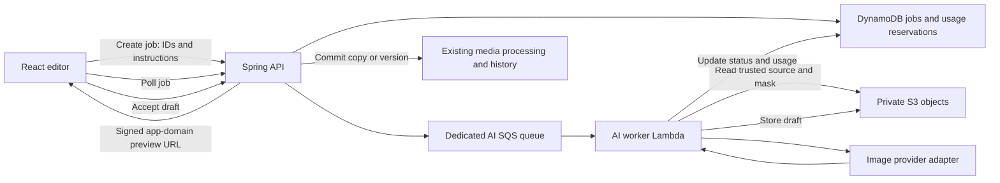

# AI features: proposed plan

Prepared 2026-10-12. Planning only: no application changes, provider calls, infrastructure provisioning or deployment are authorized by this document. Model availability, pricing and limits must be checked again when implementation starts.

## Recommendation

Keep the current canvas editor, local Auto-fix and local background removal. Add an optional AI panel for explicit requests, with generated results saved as drafts until the user accepts them. Start with object removal and natural-language edits, then background generation and expansion. Use a hosted image-editing API initially; operating GPU infrastructure is unnecessary for the first release.

Evaluate OpenAI GPT Image 2.5 Sunburst as the quality candidate, OpenAI GPT Image 2.5 Flare and Google Gemini Nano Banana 2.1 as everyday candidates, and FLUX.2 as an alternative. These are candidates, not an independently established ranking. Choose a default after comparing the same photos, prompts, output sizes, actual bills and measured latency. Keep model IDs configurable and store the selected model on every job.

## Existing foundation

- React editor renders local adjustments on canvas; Auto-fix computes histogram and color corrections rather than calling AI.
- `editor/background.worker.js` already runs `Xenova/modnet` using Transformers.js/WASM. This is local learned inference aimed at people, and needs an initial model download. Keep it available independently of cloud services.
- Spring API supports staged replacement uploads, version history, recipes and conditional photo replacement.
- AWS deployment uses S3, DynamoDB, Lambda, SQS and CloudFront; normal media should remain on the configured application domain.
- Recoverable deletion and copy/move operations preserve originals and historical versions. AI must participate in those lifecycles.
- Accounts/ownership are separately deferred. Paid AI endpoints need an owner access boundary before public enablement; an album ID alone is not authorization. Initial development can use isolated fixtures and an access-restricted preview environment.

## What users would see

An **AI tools** tab inside the existing photo editor, with these proposed tools:

| Order | Tool | Interaction and output |
| --- | --- | --- |
| 1 | Remove object | Paint over an object, choose Remove, then compare the result with the input. Composite the edited region over the source to preserve pixels outside the approved area. |
| 2 | Edit with instructions | Type “remove the cable” or “make the background softer.” Show a draft with before/after comparison and Save as copy as the default. |
| 3 | Generate background | Keep a selected subject and describe a new background; reuse existing mask refinement. Composite the original subject onto the generated background when preservation matters. |
| 4 | Expand photo | Choose a wider/taller frame and generate the extra area. Preserve the original region through compositing where applicable. |
| 5 | Restore or enhance | Offer dedicated denoise/upscale/restoration candidates separately from generative editing; warn in the tool description that reconstructed detail can differ from the source. |
| 6 | Caption/tag suggestions and subject search | Analyze reduced-size copies and suggest metadata for approval. Search embeddings index active photos only. Follow the separate metadata task first. |

Face grouping is a later, separate opt-in feature with identity, permissions and removal rules defined before work starts. AI video editing is outside the initial photo scope.

Flow: choose tool → choose input/selection and instructions → display estimated cost and size → Generate → queued/running/ready status → compare draft → Discard, Save as copy, or explicitly Save as new version. Ordinary editor slider changes never trigger paid generation. No automatic edits on upload and no AI controls on public shared albums.

## Model shortlist and selection criteria

| Candidate | Proposed role | What to verify |
| --- | --- | --- |
| `gpt-image-2.5-sunburst` | Quality baseline for instruction-driven and selected-region edits | OpenAI describes it as its most capable image generation/editing model. Test instruction adherence, subject preservation, masks, latency and costs on album fixtures. [Model documentation](https://developers.openai.com/api/docs/models/gpt-image-2.5-sunburst). |
| `gpt-image-2.5-flare` | Everyday candidate | OpenAI positions it for fast, high-quality everyday image generation. Benchmark editing and required operation support before offering it as a faster tier. [Model documentation](https://developers.openai.com/api/docs/models/gpt-image-2.5-flare). |
| `gemini-nano-banana-2.1` | Alternative everyday candidate | Google's current guide recommends it for new projects and describes image generation and conversational editing at 1K/2K/4K. Compare preservation and actual end-to-end latency. [Google image guide](https://ai.google.dev/gemini-api/docs/image-generation). |
| `flux-2-pro` | Alternative provider candidate | BFL documents generation/editing and a fixed endpoint for reproducibility. Evaluate operation compatibility; do not assume OpenAI-style mask controls. [FLUX.2 documentation](https://docs.bfl.ai/flux_2/flux2_overview). |
| Existing `Xenova/modnet` | Local person/background masking | Retain current browser behavior; evaluate quality on hair, glasses and non-person subjects before selecting any replacement. |

Separate image generation from vision analysis: a model that returns descriptions is not necessarily an image editor. Select a smaller vision model later for metadata suggestions, using structured output and explicit user approval. Specialized restoration/upscaling models need their own quality and licensing evaluation; general generative editors are not guaranteed to preserve photographic detail.

Provider adapters should advertise capabilities (mask editing, transparency, supported sizes and reference inputs). Hide or adapt unsupported operations. OpenAI's image guide documents masks and notes consistency/latency limitations; treat a mask as model guidance and use our own compositing for strict unchanged regions. [Image editing guide](https://developers.openai.com/api/docs/guides/image-generation).

## Integration architecture

The API returns quickly with a job ID. It never waits for image generation or carries large image/base64 responses through API Gateway. The worker reads trusted S3 keys resolved by the server, sends source bytes to the selected provider and stores result bytes in S3. The browser receives an app-domain signed preview URL, not a provider output URL. Avoid arbitrary URLs supplied by clients and avoid exposing provider keys in the frontend.

Start with a dedicated queue/worker so paid AI retries and latency cannot delay the existing derivative pipeline. Set bounded timeouts, reserved concurrency, DLQ, alarms and queue visibility appropriate to the worker. If selected providers require longer processing or an async status API, use submit/poll stages instead of holding a Lambda open. Validate the execution path during the provider spike rather than assuming identical APIs.

### Proposed API and job state

- `POST /api/albums/{albumId}/photos/{photoId}/ai-jobs`: operation, source version, bounded prompt, supported output size, optional mask asset ID and idempotency key. Return 202 plus job ID.
- Staged-input intent/completion endpoints: upload a current unsaved editor snapshot and mask directly to private S3, with server-controlled prefix, media validation and size limits. Never silently discard unsaved local edits; ask the user which input to use.
- `GET /api/ai-jobs/{jobId}`: authorized status, stage, safe error, result dimensions, cost information and renewable draft URL. Poll with backoff and stop polling on unmount/terminal state. Do not fabricate a progress percentage.
- `POST /api/ai-jobs/{jobId}/cancel`: cancel queued jobs, or mark running output for discard if provider cancellation is unavailable. An already submitted request may still incur cost.
- `POST /api/ai-jobs/{jobId}/accept`: save as copy or new version, with expected source version and an idempotency key. Reject stale replacement with 409; allow an explicit copy after validating album availability.
- `DELETE /api/ai-jobs/{jobId}`: discard draft and its temporary assets.

Job states: QUEUED, RUNNING, READY, FAILED, CANCELLED, ACCEPTED, EXPIRED. Acceptance also needs an atomic claim/commit guard so repeat clicks and retries cannot create multiple copies/versions. Persist owner, album/photo IDs, source version/key, operation, provider/model, prompt template version, validated parameters, asset references, provider request ID, usage/cost, timestamps, error category and retention deadline.

Store job items separately from album photo status; an AI failure never changes READY photos to FAILED. Use a jobs/outbox design or transactional state plus reconciliation so a DynamoDB write followed by a failed SQS send cannot strand a job or duplicate a bill. SQS delivery is not exactly-once: workers must claim jobs conditionally and reconcile ambiguous provider responses before retrying. Do not assume each provider supports idempotency.

### Saving and edit history

AI results are new raster assets, not reproducible slider recipes. Keep the accepted asset as an immutable version and store provenance (source version, operation, model, prompt/parameters and job ID). Do not rerun generation when reopening an editor or restoring history. Later local adjustments use that accepted raster as their base.

Reuse the existing history and conditional replacement service, extending it for server-side draft promotion. Create the destination row and provenance before writing a processing-triggering original, as the current copy pipeline does. Never overwrite an original key. Check album/photo liveness before provider submission, result publication and acceptance; deletion or permanent purge during a job must prevent late outputs from recreating media. Extend purge, recovery, move/copy and draft cleanup tests for AI provenance and assets.

## Terraform changes planned

Cloud AI requires infrastructure changes, unlike purely local adjustments:

- Dedicated AI queue, DLQ, worker Lambda, event-source mapping and concurrency limits.
- Least-privilege queue, S3, DynamoDB and secret-read permissions; confirm provider HTTPS egress and existing network configuration.
- Provider API key in Secrets Manager or an encrypted parameter; inject a reference, not plaintext credentials. Do not put the key value in Terraform variables/state.
- Job storage and atomic usage records: evaluate a dedicated DynamoDB table for isolation; add an index for owner/status/creation time only where queries require it. Define retention separately from active photo metadata.
- Private `ai-inputs/`, `ai-masks/` and `ai-drafts/` object prefixes outside existing original upload event rules. Add lifecycle cleanup for temporary assets; accepted assets must be promoted outside temporary prefixes before cleanup.
- Extend CloudFront's signed media routing and CORS configuration only if current media rules do not cover the draft prefix. Keep previews on the application's domain.
- Cost/usage metrics, queue age/error alarms and a server-side emergency disable switch. Scheduled reconciliation/cleanup handles abandoned drafts and stuck jobs; DynamoDB TTL alone does not clean S3 objects.

Before enabling in an environment, inspect a concrete Terraform plan and deploy backend capability first, then the frontend flag. Reverting the flag restores the current editor flow without deleting accepted AI versions.

## Cost, privacy and rollout controls

Each Generate/Regenerate is potentially billable. Price depends on input images, prompt, output size/quality, model and retries; add our AWS storage/worker/egress costs. Current official pricing is the reference, not a permanent per-photo promise. [OpenAI pricing](https://developers.openai.com/api/docs/pricing).

Benchmark at least 30 consented or synthetic fixtures: portraits, groups, products, landscapes, low light, transparent PNGs and mixed aspect ratios. Record pass rate, preservation outside selection, artifacts, output dimensions, median/p95 completion time and total cost per accepted result, including retries. There is no defensible “best model” until this comparison is run.

Set a configurable daily/monthly spend budget, per-request size/prompt limits, per-owner rate limit and one active generation per photo initially. Reserve budget atomically before submission and reconcile actual cost afterward; cap unknown charges conservatively. Show a range rather than a false exact quote. Never fall back to a second paid provider automatically without an explicit retry choice.

Cloud tools explicitly disclose that a copy of the selected photo is sent to the configured provider. Check retention, processing location and account data controls before selecting a provider for private albums; do not promise zero retention or EU-only processing by default. Keep sensitive payloads out of application logs. [OpenAI data controls](https://developers.openai.com/api/docs/guides/your-data). This is separate from existing local masking, where inference stays in the browser.

Start disabled by default and expose only to the owner in a restricted preview. Public rollout requires owner authentication/access controls for paid actions even if broader account features remain deferred. Existing public share routes stay view-only.

## Ordered implementation tasks for later

All tasks are **planned, not implemented**.

1. **AI-01 — Evaluate models:** fixtures, prompt templates, exact capability/size checks, privacy review, cost/latency measurements; choose one initial provider/model and record why.
2. **AI-02 — Establish access and budgets:** owner gate, feature flag, secrets, atomic spend reservation, request limits and emergency disable.
3. **AI-03 — Build job foundation:** jobs/outbox, queue/worker, provider adapter, staged assets, polling, deduplication, error handling, cancellation and cleanup. Verify with a fake provider first.
4. **AI-04 — Object removal:** touch-friendly brush/erase/undo, correct EXIF/rotation/crop-to-source mask coordinates, model edit, localized compositing, comparison and explicit save. Ship this vertical slice before adding more tools.
5. **AI-05 — Instruction editing:** bounded instructions, draft results, Save as copy default, optional new version and provenance/history handling.
6. **AI-06 — Background generation:** subject-mask refinement and original-subject compositing; keep local background removal available.
7. **AI-07 — Expansion:** frame controls, provider capability checks, original-region preservation and aspect-ratio/export checks.
8. **AI-08 — Restoration/upscaling:** specialized-model evaluation followed by optional controls; keep separate from current Auto-fix.
9. **AI-09 — Metadata/search:** depends on titles/descriptions/tags; approved suggestions and a separate search index with delete/restore synchronization. Face grouping needs a separate plan.

For every release, verify uploads, ordinary adjustments/Auto-fix, video playback, sharing, favorites, ZIPs, ordering, versions, copy/move, recovery and mobile layouts. Test expired signed URLs, reload during generation, network failure, double submit, repeated queue delivery, timeout after provider acceptance, malformed/missing output, budget exhaustion and deletion/concurrent edit during processing. Use fixture photos and keep live media unchanged.

Done means: draft generation is visible and recoverable, saving is explicit and idempotent, originals/history survive, job failure leaves ordinary editing usable, cost is bounded, temporary storage is reclaimed, and disabling AI leaves current album behavior working.
